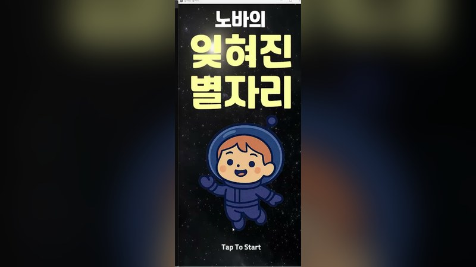
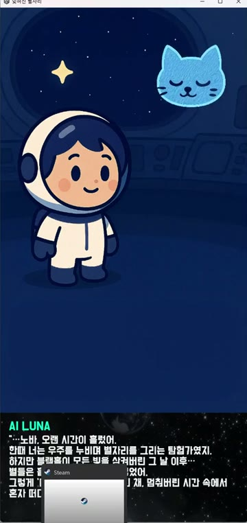
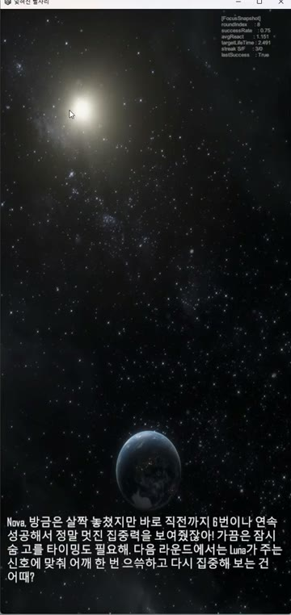
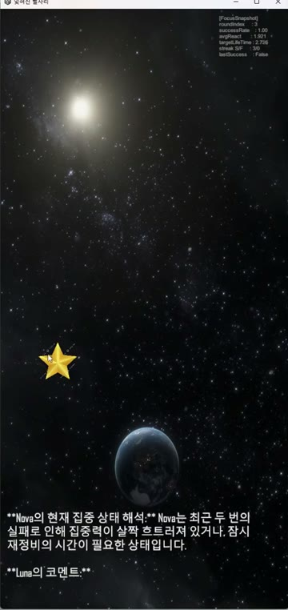

<p align="center"></p>

# 잊혀진 별자리

> 플레이 기록으로 난이도를 스스로 맞추고, AI 코치 '루나'가 말을 걸어 주는 집중력 훈련 게임
> 아주대학교 AI융합캡스톤디자인1(2025-2) · 2인 팀 · 2025.09 – 2025.12

## ▶ 플레이 영상

https://github.com/user-attachments/assets/b687f014-6a5f-43ba-8f74-c82c5fbd46b5

<p align="center">반응 게임 · 난이도 조절 · 루나 피드백 시연 · 1분 18초 (왼쪽은 피드백 서버 로그)</p>

## 한 줄 소개

집중력이 떨어져 "혹시 ADHD일까" 고민하지만 검사는 부담스러운 사람이, 게임을 하며 자기 집중 패턴을 가볍게 알아볼 수 있게 만든 프로토타입입니다.
우주선 파일럿 노바가 되어 별빛 신호에 반응하면, 강화학습 Agent가 난이도를 맞추고 AI 동료 루나가 플레이를 보고 말을 걸어 줍니다. 의료용 진단 도구가 아니라는 안내를 시작 화면에 넣었습니다.

| AI 코치 루나 | 반응 게임과 루나 코멘트 | 별빛 신호 |
|---|---|---|
|  |  |  |

## 게임 흐름

```
시작 화면(진단 도구 아님 안내) → 인트로 스토리 → 게임 선택 → 반응 게임
                                                     │ 라운드마다 반응시간·성공 기록
                                                     ├─▶ 난이도 Agent(ONNX)가 별이 떠 있는 시간을 1~3초 안에서 조절
                                                     └─▶ 20초마다 플레이 요약 → 피드백 서버 → 루나의 한 문단 코멘트
```

## 주요 기능

| 영역 | 내용 |
|---|---|
| 반응 게임 | 화면에 나타난 별을 제한 시간 안에 누르는 라운드 반복. 최근 10회 반응시간과 누적 성공률 기록 |
| 난이도 Agent | Unity ML-Agents(PPO). 관측 3개(현재 유지시간, 최근 평균 반응시간, 누적 성공률) → 유지시간을 한 번에 ±0.15초, 1~3초 범위에서 조절. 실패 −1, 성공률이 70%에 가까울수록 + 보상 |
| 학습 | 반응시간을 정규분포(평균 0.8초, 표준편차 0.25초)로 뽑고 15% 확률로 놓치는 자동 플레이 봇과 학습. 학습한 정책을 ONNX로 게임에 넣고 추론 확인 스크립트로 검증 |
| AI 코치 루나 | 라운드 수·성공률·평균 반응시간·연속 성공/실패를 JSON으로 로컬 Flask 서버에 보내면, 서버가 Gemini로 "노바를 돕는 동료 루나" 말투의 코멘트를 만들어 게임에 표시 |
| 연출 | 인트로 스토리, 페이드인 텍스트, 떠다니는 이미지, 깜빡임 효과 |

## 팀과 역할

2인 팀(강나연, 송재혁). 디자인씽킹(인터뷰·AEIOU → 5 Whys → 페르소나 3명)으로 기획을 함께 정리했습니다.

### 내가 맡은 일 (송재혁)

- **난이도 Agent와 보상 설계, 자동 플레이 봇, ONNX 적용과 검증**
- **루나 피드백:** Unity 쪽 플레이 요약 전송과 Flask + Gemini 피드백 서버
- **게임 흐름:** 시작·인트로·게임 선택·반응 게임 씬과 연출

## 코드

| 폴더 | 내용 |
|---|---|
| `src/Unity/` | `DifficultyAgent`(Agent), `ReactionGameManager`(반응 게임), `AutoClickBot`(학습 봇), `OnnxSanityTest`(추론 확인), `FeedbackClient`(루나 요청), 씬·연출 스크립트 |
| `src/server/app.py` | Flask 피드백 서버. 실행하려면 환경 변수 `GEMINI_API_KEY`가 필요합니다 |
| `training/difficulty_config.yaml` | PPO 학습 설정 (은닉 64×2, 학습률 3e-4, 50,000 스텝) |

## 기술 스택

Unity 6 · C# · Unity ML-Agents (PPO) · ONNX 추론 · Python · Flask · Gemini API

## 한계

자동 플레이 봇은 반응시간 분포가 고정이라 사람처럼 실력이 바뀌지 않습니다. 기획한 여러 미니게임과 리포트 기능 중 반응 게임과 루나 피드백까지 구현했습니다.
